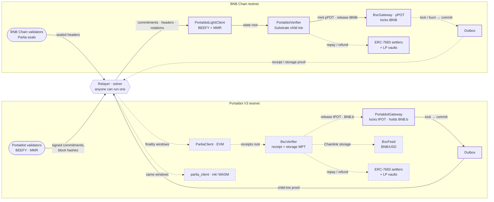

# Backhaul

**Move tPOT to BNB Chain and tBNB to Portaldot with nobody in the middle who can take it.**

Bridges secured by a handful of keys have lost about **$806M** in three incidents alone: Ronin (5 of 9 validator keys, ~$625M)<sup>[1](#sources)</sup>, Harmony Horizon (2-of-5 multisig, ~$100M)<sup>[2](#sources)</sup> and Orbit Chain (7 of 10 multisig signers, $81.5M)<sup>[3](#sources)</sup>. Backhaul has no keys to steal. Each chain runs a light client of the other, and a contract releases funds only against a proof of the other chain's finalized state, in both directions.

Built for the Portaldot Hacker House 2026, Multi-Chain & Cross-Chain Infra track. Portaldot V3 testnet and BNB Chain testnet only.

<!-- render:status -->
**Status, 2026-11-04 09:39 UTC:** deployed, 2 contracts on Portaldot V3 testnet and 8 on BNB Chain testnet; 1 proven transfer and 0 fast fills recorded. Every address and transaction: [docs/PROOF.md](docs/PROOF.md).
<!-- /render:status -->

## What it does

- **Portaldot → BNB Chain.** Lock tPOT on Portaldot. pPOT is minted on BNB Chain once a BEEFY light client there has proven the lock. Burn pPOT to come back.
- **BNB Chain → Portaldot.** Lock tBNB on BNB Chain. BNB.b, a native Portaldot asset, is released once a Parlia light client on Portaldot has proven the lock. Return BNB.b to unlock your tBNB.
- **Fast, still without trust.** Open an ERC-7683 order instead. A solver pays you on the destination chain within seconds, from its own funds, and is repaid only after the light client proves the fill. If nobody fills by the deadline, a proof that nobody did refunds you.
- **Data as well as assets.** Any Portaldot contract can read proven BNB Chain state. `BscFeed` serves Chainlink's BNB/USD price on Portaldot from storage proofs.
- **Anyone can relay.** The relayer only carries proofs. It can delay a transfer, never forge one. Run your own with `npm run relayer`.

## Try it

<!-- render:live-links -->
| What | Link | State |
| --- | --- | --- |
| Landing | [backhaul-bridge.vercel.app](https://backhaul-bridge.vercel.app) | live; reads both chains directly |
| App: bridge both ways | [/app](https://backhaul-bridge.vercel.app/app) | live |
| Attack lab | [/attacks](https://backhaul-bridge.vercel.app/attacks) | live; Fire all runs every forged proof |
| Light-client status | [/status](https://backhaul-bridge.vercel.app/status) | live |
| Relayer API | [35-205-62-150.sslip.io](https://35-205-62-150.sslip.io/status) ([API.md](services/relayer/API.md)) | live |
<!-- /render:live-links -->

Reviewing? Take the five-minute path in [docs/JUDGES.md](docs/JUDGES.md). Every claim and its evidence tier: [docs/CLAIMS.md](docs/CLAIMS.md).

## How it works

<!-- render:architecture -->


Solid: built and executed against the live testnets. Dotted: built and tested, not yet executed on a testnet. Dashed boxes: not deployed yet.
<!-- /render:architecture -->

### Portaldot → BNB Chain: a BEEFY light client on BNB Chain

`PortaldotLightClient` follows BEEFY, the finality gadget Portaldot already runs for bridges.

1. **Commitments.** Portaldot's BEEFY validators sign `keccak256(SCALE(commitment))`. The commitment carries the root of a Merkle Mountain Range (MMR) over every block. The contract recovers each secp256k1 signature and needs more than two thirds of the current set (2 of 2 on the testnet).
2. **Headers.** Each MMR leaf is `keccak256(SCALE(u32 parent number, parent hash))`. A header is imported with an MMR proof against a signed root. Its BLAKE2b-256 hash, computed with the EIP-152 precompile, must match the leaf. Then its state root is stored.
3. **Contract storage.** pallet-revive keeps each contract's storage in a child trie. `PortaldotVerifier` checks a Substrate main-trie proof of the child root, then a child-trie proof of the Outbox slot under `blake2_256(slot)`, against the imported state root. The Outbox's trie id is bound once, by anyone, from a proof of `Revive::AccountInfoOf`.
4. **Validator rotation.** The set id moves on every session. `rotate` proves `Beefy::ValidatorSetId` and `Beefy::NextAuthorities` from the storage of an imported header and checks that every new key lies on the secp256k1 curve.

The public nodes can't serve MMR proofs, so the SDK rebuilds the MMR from block hashes and checks its root against the chain's own: [docs/FINDINGS.md](docs/FINDINGS.md).

### BNB Chain → Portaldot: a Parlia light client on Portaldot

`ParliaClient` runs on Portaldot's EVM (pallet-revive) and brings BNB Chain's finality onto Portaldot.

1. **Seals.** Every BSC header carries its sealer's ECDSA signature. The client rebuilds the seal hash, recovers the signer (low-s only) and requires it to be the header's coinbase.
2. **Finality.** A window of consecutive, parent-linked headers finalizes its first header once it carries seals from at least ⌈2N/3⌉ distinct validators of the trusted set: 6 of 9 on the testnet. That is the same two-thirds threshold BSC's own fast finality uses.
3. **Skipping, with a trusting period.** Like IBC light clients, it need not follow every epoch. A window verifies while its first header is within 14 days of the trusted set's epoch block and it lands on Portaldot within 14 days of the moment the client installed that set, so a stale set's keys are worthless after two weeks whatever they stamp into a header. A new set takes effect at `E + (⌊N/2⌋+1) · turnLength`, as BSC's `snapshot.go` does. The last 256 finalized headers live in a ring buffer, so storage deposits stop growing once it is full.
4. **Proofs.** Locks and fills are proven with a receipt proof of the Outbox's `Committed` log against `receiptsRoot`, or, if that block can no longer be finalized, with a storage proof of the same write-once Outbox slot at any later finalized block. Refunds and data reads use account and storage proofs against `stateRoot`.

### Fast fills: ERC-7683, repaid after proof

`OriginSettler.open` escrows the input and commits the order to the Outbox. A solver calls `DestinationSettler.fill` on the other chain and pays the recipient at once; the fill is committed to that chain's Outbox. `settle` pays the escrow to the solver only after the light client proves that commitment. `refund` returns it to the user after the deadline, against a proof that the slot is still empty.

### Proof-gated LP vaults

An `LPVault` on each chain pools liquidity for fills. It fills an order only with a light-client proof that the order was opened on the origin chain, so there is no operator key, and it earns the fill fee. Repayments travel home over the canonical bridge through `RepayForwarder`. Each fee vests over 6 hours, so a deposit and a withdrawal wrapped around the repayment get none of it.

### BNB.b: a native asset, not a wrapped contract

Bridged tBNB arrives as BNB.b, a `pallet-assets` asset. Its whole fixed supply is minted to the gateway contract, and every asset role (owner, issuer, admin, freezer) is handed to it, so circulating BNB.b always equals locked tBNB. It works as an ERC-20 through the assets precompile and shows up in Substrate wallets. Because the asset is non-sufficient, a fresh account gets a 0.5 tPOT gas drop with its first BNB.b.

### BscFeed: a data bridge

`BscFeed` reads the Chainlink BNB/USD proxy and its aggregator on BNB Chain testnet from storage proofs against a Parlia-finalized header, and exposes `latestRoundData()` on Portaldot. Anyone can update it. Nobody can set a price.

### The ink! twin

`ink/parlia_client` is the same Parlia client as an ink! contract on Portaldot's WASM side (pallet-contracts), so ink! contracts get proven BNB Chain state too. Both builds take byte-identical inputs in [docs/BENCHMARK.md](docs/BENCHMARK.md).

## Numbers

<!-- render:numbers -->
|  | Number | Source |
| --- | --- | --- |
| Keys that can release bridged funds | 0 on either chain | No owner, admin, pause or upgrade path in any contract: [TRUST.md](docs/TRUST.md) |
| Tests | 434 passing, 0 failing: Foundry 263 · SDK 92 (+2 live-only, skipped offline) · relayer 44 · ink! 35 | `npm run test:counts` → [results/test-counts.json](results/test-counts.json) at `e77b97d` |
| Forged proofs rejected, local rehearsals | 11 of 11 fired; `replayed-nonce` needs a live transfer (forge: `test_finalizeTwiceReverts`) | [rehearsal-beefy.json](results/rehearsal-beefy.json) · [rehearsal-parlia.json](results/rehearsal-parlia.json) |
| Forged proofs rejected, testnet | 6 of 6 (eth_call) | [results/attacks.json](results/attacks.json) |
| BEEFY on BNB Chain: commitment · header import · set rotation | 103,370 · 109,482 · 420,353 gas | Foundry on recorded Portaldot data ([beefy-gas-local.json](results/beefy-gas-local.json)); the BSC-fork rehearsal rotated set 520 → 521 on live Portaldot data |
| Portaldot contract storage proven on BNB Chain | 573,322 gas (main trie + child trie, 3,428 B calldata) | [beefy-gas-local.json](results/beefy-gas-local.json) |
| BNB Chain finality on Portaldot (EVM) | 44 real headers, 39.3 kB, 7 distinct sealers → final for 1,669,820 gas | [rehearsal-parlia.json](results/rehearsal-parlia.json) |
| EVM vs WASM, 48 real headers, same input | 1,827,194 execution gas vs 12.32 ms refTime, 30.8 kB proofSize | [BENCHMARK.md](docs/BENCHMARK.md) |
| Wait for BNB Chain finality | 42–44 headers ≈ 19–20 s | MODELED: header counts from the rehearsal windows × 0.45 s blocks |
| Time to funds, canonical (median) | Portaldot → BNB Chain 40 s · BNB Chain → Portaldot not measured yet | [live-transfers.json](results/live-transfers.json) |
| Time to funds, fast fill (median) | Portaldot → BNB Chain not measured yet · BNB Chain → Portaldot not measured yet | [live-transfers.json](results/live-transfers.json) |
| Deploy cost, full | 3,138 tPOT + 0.0112 tBNB, of which 26 tPOT and 0.01 tBNB seed the gas pool and vaults | Dry-run: live `eth_estimateGas` on Portaldot, fork gas on BSC ([deploy-cost-estimate.json](results/deploy-cost-estimate.json)) |
| User cost on Portaldot | bridge tPOT 3.92 tPOT · open an order 7.86 tPOT | Fees plus storage deposit, same dry-run |
<!-- /render:numbers -->

Rendered by `npm run docs` from `results/*.json` and `deployments/*.json`. Nothing in this table is typed by hand.

## Run it yourself

Needs Node 22+, [Foundry](https://getfoundry.sh) and Rust (for the ink! crate).

```sh
git clone --recursive https://github.com/RaYYeR220/backhaul && cd backhaul && npm ci

npm run test:counts      # forge, SDK, relayer and ink! suites → results/test-counts.json
npm run deploy:dry       # prices the whole deployment against the live chains; sends nothing
npm run rehearse         # both proof paths on local nodes fed with live testnet data
npm run benchmark        # EVM vs WASM on identical inputs → docs/BENCHMARK.md
npm run verify:onchain -- <tx>   # re-check a transfer against the deployed light client
cd app && npm ci && npm run dev  # the web app; point NEXT_PUBLIC_RELAYER_URL at a relayer
```

`npm run rehearse:beefy -- --rotate` also waits for the next Portaldot session (up to an hour) and rotates the BEEFY client live. To deploy for real: `npm run deploy -- --env <file>` with the variables in [.env.example](.env.example), then `npm run relayer -- --env <file>`. After that, `npm run record:live` and `npm run docs` fill [docs/PROOF.md](docs/PROOF.md).

## Honest limits

The full trust model, direction by direction: [docs/TRUST.md](docs/TRUST.md).

- **Testnet only, not audited.** No mainnet deployment.
- **Portaldot's own validators are trusted.** The testnet has 2 BEEFY validators, and the chain's sudo key can change its runtime.
- **BNB Chain finality is checked from ECDSA seals, not BLS votes.** Portaldot has no BLS12-381 precompile. The client trusts that two thirds of each BSC validator set it installs stay honest for 14 days.
- **Immutable on purpose.** If a light client ever stops accepting updates, the fix is a new deployment, not an admin key.
- **Liveness needs a relayer.** If nobody relays, transfers wait. Ours runs on one small VM; anyone can run another. If nobody moves the Parlia client to a newer epoch for 14 days, it needs a new deployment; the relayer does it every 3 days.
- **Fast fills need liquidity.** A solver with its own funds fills in seconds. A vault fill waits for the proof that the order was opened, so it is only as fast as origin finality.

## Repository

| Path | What |
| --- | --- |
| `contracts/` | Solidity (Foundry): light clients, verifiers, gateways, Outbox, ERC-7683 settlers, LP vaults, BscFeed |
| `ink/parlia_client` | The ink! twin of the Parlia light client; `ink/bench` measures it in pallet-contracts |
| `packages/sdk/` | TypeScript proof builders (BEEFY, MMR, Substrate trie, Parlia, MPT), deploy, attack lab, scripts |
| `services/relayer/` | Permissionless relayer, solver and HTTP API ([API.md](services/relayer/API.md)) |
| `app/` | Web app (Next.js) |
| `results/` | Every measurement, as JSON; the docs render from it |
| `docs/` | [JUDGES](docs/JUDGES.md) · [CLAIMS](docs/CLAIMS.md) · [PROOF](docs/PROOF.md) · [TRUST](docs/TRUST.md) · [BENCHMARK](docs/BENCHMARK.md) · [FINDINGS](docs/FINDINGS.md) · [CHALLENGE_CHECKLIST](docs/CHALLENGE_CHECKLIST.md) |

## Third-party code

- [polytope-labs/solidity-merkle-trees](https://github.com/polytope-labs/solidity-merkle-trees) (Apache-2.0), commit `6bbc83d`: trie primitives. `contracts/src/lib/substrate/SubstrateTrie.sol` is adapted from its `PolkadotTrie.sol` to BLAKE2b-256 node hashing and child tries; the changes are listed in the file header. Its `EthereumTrie` is used in tests as a cross-check.
- [OpenZeppelin Contracts](https://github.com/OpenZeppelin/openzeppelin-contracts) v5.1.0 (MIT): `SafeERC20`, `IERC20`.
- [ink!](https://github.com/use-ink/ink) 5.1.1 (Apache-2.0) for the WASM twin; `ink_sandbox` for its benchmark.
- [forge-std](https://github.com/foundry-rs/forge-std) for tests. npm and cargo dependencies are pinned in `package-lock.json` and `Cargo.lock` under their own licences.

## Sources

1. Ronin: 5 of 9 validator keys, 173,600 ETH and 25.5M USDC. [Chainalysis](https://www.chainalysis.com/blog/axie-infinity-ronin-bridge-dprk-hack-seizure/), [Ronin](https://blog.roninchain.com/p/the-ronin-bridge-is-open-), [Halborn](https://www.halborn.com/blog/post/explained-the-ronin-hack-march-2022) (about $624M).
2. Harmony Horizon: a 2-of-5 multisig, about $100M. [Elliptic](https://www.elliptic.co/insights/the-100-million-horizon-hack-following-the-trail-through-tornado-cash-to-north-korea/), [FBI](https://www.fbi.gov/news/press-releases/fbi-confirms-lazarus-group-cyber-actors-responsible-for-harmonys-horizon-bridge-currency-theft).
3. Orbit Chain: 7 of 10 multisig signers, $81.5M. [Blockworks](https://blockworks.co/news/80-million-lost-orbit-bridge), [Orbit Chain](https://medium.com/orbit-chain/official-statement-regarding-orbit-bridge-exploit-551928f3dc52).

## License

MIT
